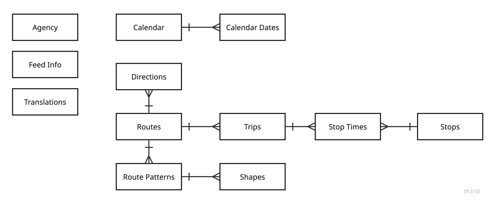

# Streaming Transit Data

A streaming data pipeline for transit data. This repository holds python packages and scripts that:
- **Poller** - Read and extract data from GTFS real-time transit feed. Sends data to a Kafka topic.
- **Producer** (Topic) - Receives messages from one or many GTFS feeds and publishes to topic. One topic per feed type.
- **Consumer** - 
  - Apache Flink - Joins the static data with real-time data & sends to Kafka topic
  - WebSocket Server - Subscribes to the Kafka topic and reads messages and pushes to web socket
- **Display** - Website that opens websocket and receives later


The static data model looks like...



This codebase used best practices from https://www.transit-data.com/.

## Prerequiste

- Download and create kafka topic:
    ```bash
    docker run -d --name kafka -p 9092:9092 apache/kafka:latest
    kafka-topics --create --topic vehicle-positions --bootstrap-server localhost:9092
    ```
  
## Run 

- Start Kafka server on Docker
    ```bash
    docker run -d --name kafka -p 9092:9092 apache/kafka:latest
    ```
- Run poller
    ```bash
    uv run poller.py
    ```
- View Kafka messages
  ```bash
   kafka-console-consumer --topic vehicle-positions --from-beginning --bootstrap-server localhost:9092 --property print.key=true --property print.timestamp=true 
  ```