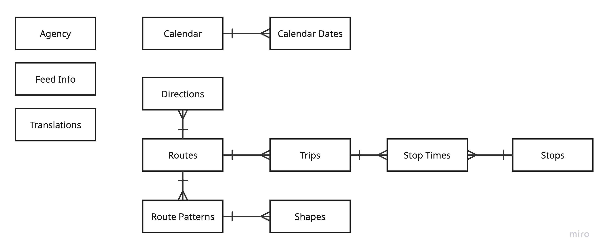

# Streaming Transit Data

A streaming data pipeline for transit data (Kafka, PostGIS, FastAPI/SSE, MapLibre).

This repository holds an installable Python package (`transit`) with three runtime components:
- **Realtime Poller (`transit-poller`)** — Polls GTFS-Realtime feeds (e.g. STM vehicle positions) and publishes records to Kafka.
- **Static Loader (`transit-ingest-static`)** — Bulk-loads static GTFS feeds into PostGIS and builds connected route geometry shapes.
- **Web API & UI (`transit.api.main:app`)** — Serves static route/stop GeoJSON from PostGIS, enriches real-time vehicle positions from Kafka with predicted street-snapped trajectories over Server-Sent Events (SSE), and hosts the MapLibre web UI.

The static data model looks like:



This codebase uses best practices from https://www.transit-data.com/.

## Repo Structure

```text
streaming/
├── pyproject.toml              # name=transit, [project.scripts], dev deps, ruff/pytest config
├── uv.lock
├── .python-version
├── .env.example                # documented env template; .env stays gitignored
├── compose.yaml                # production-like container stack
├── compose.override.yaml       # dev-only hot reload + bind mounts (auto-loaded locally)
├── Dockerfile                  # multi-stage uv build, shared image for all Python services
├── README.md
├── db/
│   └── init/
│       └── 001_schema.sql      # PostGIS schema auto-applied on first container start
├── frontend/                   # MapLibre static web UI served by FastAPI at /
│   ├── index.html
│   └── app.js
├── data/                       # gitignored GTFS downloads
├── docs/images/gtfs-erd.png
├── src/
│   └── transit/
│       ├── __init__.py
│       ├── settings.py         # lazy env settings (Kafka, Postgres, feed API keys)
│       ├── log.py              # shared logging setup
│       ├── infra/              # external system adapters (no business logic)
│       │   ├── __init__.py
│       │   ├── db.py           # psycopg_pool connection pool
│       │   ├── kafka.py        # producer/consumer factories
│       │   └── topics.py       # Kafka topic constants
│       ├── gtfs_realtime/      # GTFS-RT → Kafka worker
│       │   ├── __init__.py
│       │   ├── feeds.py        # feed registry (STM, MBTA)
│       │   ├── poller.py
│       │   ├── publisher.py
│       │   ├── parsers/
│       │   │   ├── __init__.py
│       │   │   ├── vehicle_positions.py
│       │   │   ├── trip_updates.py
│       │   │   └── service_alerts.py
│       │   └── cli.py          # `transit-poller` entry point
│       ├── gtfs_static/        # GTFS static → Postgres batch job
│       │   ├── __init__.py
│       │   ├── loader.py
│       │   └── cli.py          # `transit-ingest-static` entry point
│       └── api/                # FastAPI web service
│           ├── __init__.py
│           ├── main.py         # create_app(), lifespan pool open/close, mounts frontend/
│           ├── routes/
│           │   ├── __init__.py
│           │   ├── static.py   # /api/static/routes, /api/static/stops
│           │   └── stream.py   # /api/stream/vehicle_positions (SSE)
│           └── services/
│               ├── __init__.py
│               └── vehicle_predictor.py
└── tests/
    ├── test_settings.py
    ├── test_vehicle_positions_parser.py
    └── test_api_smoke.py
```

## Prerequisites

- Docker & Docker Compose (or Python 3.13 + `uv` for local runs)
- Copy `.env.example` to `.env` and fill in `STM_API_KEY`:
  ```bash
  cp .env.example .env
  ```

## Run with Docker Compose

- Start Kafka, Kafka-UI, PostGIS, the GTFS-Realtime poller, and the Web API (with hot reload):
  ```bash
  docker compose up --build
  ```
- Load static GTFS data into PostGIS (one-time or when static feed updates):
  ```bash
  docker compose run --rm ingest --path data/GTFS_STM --agency-id STM
  ```
- Open in browser:
  - **Map UI & API:** `http://localhost:8000`
  - **Kafka UI:** `http://localhost:8080`
- Stop all containers:
  ```bash
  docker compose down
  ```

## Run Locally with `uv`

```bash
uv sync
uv run transit-ingest-static --path data/GTFS_STM --agency-id STM
uv run transit-poller --agency STM
uv run uvicorn transit.api.main:app --reload --port 8000
```

## Tests & Linting

```bash
uv run pytest
uv run ruff check
```

## Data Attribution & Terms of Use

Transit data is provided by the [Société de transport de Montréal (STM)](https://www.stm.info/en/about/developers) under the [Creative Commons Attribution 4.0 (CC BY 4.0)](https://creativecommons.org/licenses/by/4.0/) licence. This is an unofficial project and is not affiliated with or endorsed by the STM.

- [ ] **TODO:** Add the STM attribution and unofficial-site disclaimer footer to the website (`frontend/index.html`) before publishing publicly.
